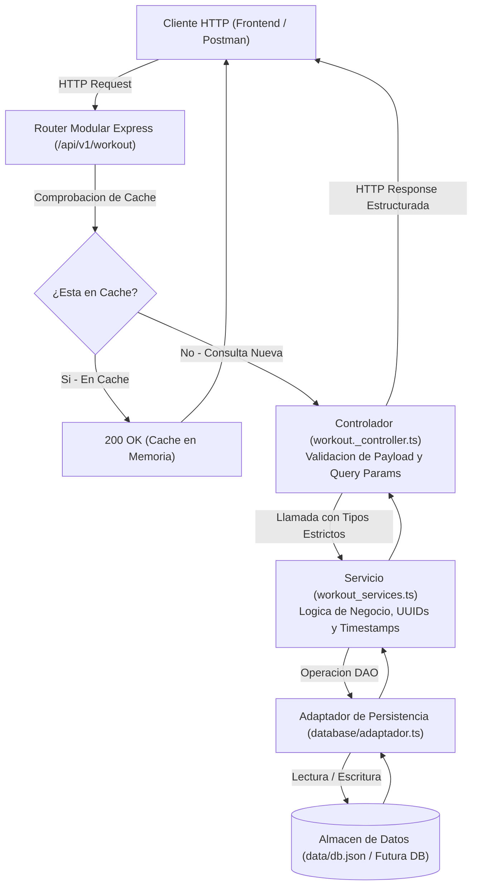

<div align="center">

# TypeScript Express Clean API — Servicio Backend RESTful en Capas
### **API REST Modular para Gestión de Entrenamientos, Miembros y Marcas Deportivas**

<p align="center">
  
  
</p>

<!-- Iconos Tecnológicos con Nombre -->
<table align="center">
  <tr>
    <td align="center" width="110">
      
      <br><sub><b>TypeScript</b></sub>
    </td>
    <td align="center" width="110">
      
      <br><sub><b>Node.js</b></sub>
    </td>
    <td align="center" width="110">
      
      <br><sub><b>Express 5</b></sub>
    </td>
    <td align="center" width="110">
      
      <br><sub><b>In-Memory Cache</b></sub>
    </td>
  </tr>
</table>

**Servicio backend desarrollado en Node.js y Express 5 con tipado estricto en TypeScript. Implementa una arquitectura por capas desacoplada que separa el enrutamiento, los controladores HTTP, la lógica de negocio y la capa de acceso a datos (DAO/Adaptador).**

[Arquitectura en Capas](#1-arquitectura-del-software) • [Flujo de una Petición](#2-flujo-de-datos-de-una-petición) • [Especificación de Endpoints](#3-especificación-de-endpoints-api-v1) • [Filtrado por Query Params](#4-filtrado-avanzado-por-query-params) • [Manejo de Errores](#5-manejo-de-errores-y-códigos-http) • [Roadmap](#6-roadmap-de-desarrollo-continuo) • [Instalación](#7-instalación-y-ejecución)

</div>

---

## 1. Arquitectura del Software

El proyecto sigue una **arquitectura por capas (Layered Architecture)** para garantizar la separación de responsabilidades, la testeabilidad y la mantenibilidad:

```text
src/
├── config/                  # Variables de entorno y configuración del servidor (env.ts)
├── controllers/             # Manejo de petición/respuesta HTTP, validación de body y query params
│   └── workout._controller.ts
├── database/                # Capa de Acceso a Datos (DAO / Patrón Adaptador de Persistencia)
│   └── adaptador.ts
├── services/                # Lógica de negocio pura, generación de UUID v4 y marcas de tiempo ISO
│   └── workout_services.ts
├── types/                   # Definición de tipos e interfaces TypeScript
│   └── workout-interface.ts
├── utils/                   # Clases auxiliares y normalización de errores (HttpError)
│   └── http_error.ts
├── v1/                      # Versionado semántico de la API
│   └── routes/              # Declaración modular de rutas con Router() y middleware de cache
│       └── index.ts
└── index.ts                 # Punto de entrada de la aplicación Express
```

### Principios de Diseño Aplicados:
- **Desacoplamiento de Persistencia (Patrón Adaptador):** El controlador y el servicio no interactúan directamente con el almacenamiento. Toda operación de lectura/escritura pasa por `adaptador.ts`, lo que permite sustituir el almacenamiento actual por una base de datos relacional (MySQL / PostgreSQL) sin modificar la capa de negocio ni las rutas.
- **Tipado Estricto de Dominio:** Interfaces dedicadas (`Workout`, `WorkoutRecord`, `Miembro`, `Database`, `Filtros`) que evitan el uso de tipos genéricos `any`.
- **Caché en Memoria (`apicache`):** Middleware de caché configurado en lecturas masivas (`GET /api/v1/workout`) para optimizar el rendimiento y reducir operaciones de E/S.

---

## 2. Flujo de Datos de una Petición



---

## 3. Especificación de Endpoints (API v1)

Base URL: `http://localhost:3002/api/v1/workout`

| Método | Endpoint | Middleware | Código Éxito | Descripción |
| :--- | :--- | :--- | :--- | :--- |
| `GET` | `/` | `cache("1 minutes")` | `200 OK` | Obtiene la lista de entrenamientos (soporta filtros por query). |
| `GET` | `/:id` | Ninguno | `200 OK` | Obtiene un entrenamiento específico por su identificador UUID. |
| `POST` | `/` | Ninguno | `201 Created` | Crea un nuevo entrenamiento validando campos obligatorios. |
| `PATCH` | `/:id` | Ninguno | `200 OK` | Actualiza parcialmente los campos de un entrenamiento existente. |
| `DELETE` | `/:id` | Ninguno | `204 No Content` | Elimina un entrenamiento de la base de datos por ID. |

### Formato Estándar de Respuesta
Todas las respuestas de la API siguen una estructura JSON consistente:
```json
{
  "status": "OK",
  "data": { ... }
}
```

En caso de fallo o validación incorrecta:
```json
{
  "status": "FAILED",
  "data": {
    "error": "Mensaje descriptivo del error"
  }
}
```

---

## 4. Filtrado Avanzado por Query Params

El endpoint `GET /api/v1/workout` permite combinar parámetros de búsqueda en la URL:

```bash
# Filtrar por modo de entrenamiento
curl "http://localhost:3002/api/v1/workout?mode=AMRAP"

# Filtrar por equipamiento necesario
curl "http://localhost:3002/api/v1/workout?equipment=barbell"

# Limitar el número de resultados devueltos
curl "http://localhost:3002/api/v1/workout?limit=2"

# Combinar múltiples criterios
curl "http://localhost:3002/api/v1/workout?mode=For%20Time&limit=1"
```

---

## 5. Manejo de Errores y Códigos HTTP

- **`200 OK`**: Petición resuelta satisfactoriamente (consultas y modificaciones parciales).
- **`201 Created`**: Recurso creado con éxito, devolviendo el objeto generado con su UUID y fechas.
- **`204 No Content`**: Eliminación completada sin contenido en el cuerpo de respuesta.
- **`400 Bad Request`**: Faltan campos requeridos en el cuerpo de creación (`name`, `mode`, `equipment`, `exercises`, `trainerTips`).
- **`404 Not Found`**: El identificador solicitado no existe en la base de datos o se intentó modificar campos protegidos de auditoría (`id`, `createdAt`).

---

## 6. Roadmap de Desarrollo Continuo

- [x] **Fase 1 (Completada):**
  - Configuración del entorno con Express 5 y TypeScript.
  - Implementación de la arquitectura en capas (Rutas, Controladores, Servicios, DAO).
  - CRUD completo para la entidad `Workout` con validaciones y timestamps.
  - Middleware de caché en memoria con `apicache`.
  - Filtros dinámicos en consultas (`mode`, `equipment`, `createdAt`, `limit`).
- [ ] **Fase 2 (En desarrollo):**
  - Implementación de controladores y servicios para `Members` (registro y autenticación).
  - Gestión de `WorkoutRecords` (registro de marcas y marcas personales por miembro).
  - Middlewares de seguridad activos (`helmet`, `cors`).
- [ ] **Fase 3 (Próxima):**
  - Documentación interactiva con OpenAPI / Swagger (`swagger-ui-express`).
  - Migración del adaptador de persistencia a base de datos relacional MySQL.

---

## 7. Instalación y Ejecución

### Prerrequisitos
- Node.js (versión 20.x o superior recomendada)
- npm (versión 10.x o superior)

### Pasos de Instalación
```bash
# 1. Clonar el repositorio
git clone https://github.com/Angeell04/typescript-express-clean-api.git
cd typescript-express-clean-api

# 2. Instalar dependencias
npm install

# 3. Iniciar el servidor en modo desarrollo (con hot-reload vía tsx)
npm run dev
```

El servidor iniciará por defecto en `http://localhost:3002`.

---

## Autor

**Ángel Miranda Molina**  
*Estudiante de 2º de DAM (Desarrollo de Aplicaciones Multiplataforma)*  

[](https://www.linkedin.com/in/%C3%A1ngel-miranda-75966b344/)
[](https://github.com/Angeell04)
